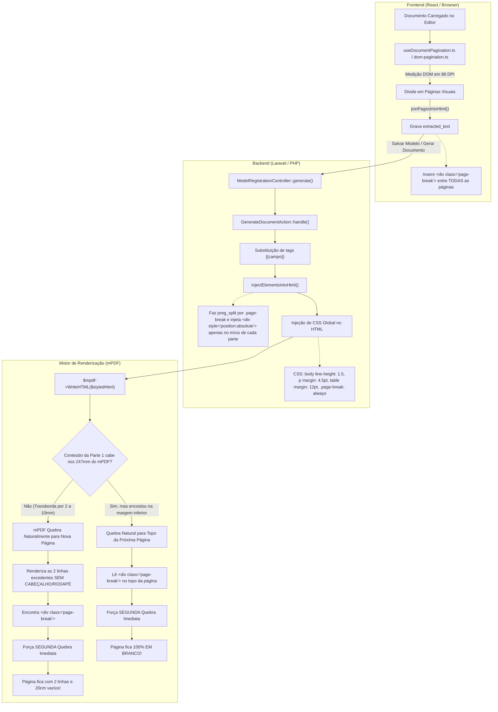
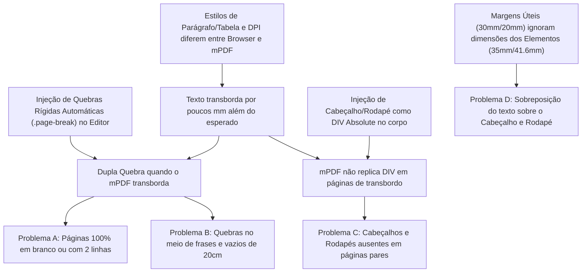

# Análise Técnica dos Problemas de Paginação e Cabeçalhos no PDF

**Sistema de Geração de Documentos e Editais — UNESC**  
**Data:** 21 de outubro de 2026  
**Documento de Diagnóstico Arquitetural e Plano de Correção**  
**Arquivo Alvo:** `Analise dos problemas de paginacao e cabecalhos no PDF.md`

---

## 1. Resumo Executivo

Durante os testes de homologação do fluxo de preenchimento e geração de documentos no sistema de editais da UNESC, foram observadas anomalias críticas na composição do arquivo PDF final:
1. **Páginas totalmente em branco** intercaladas no documento (ex.: Página 2 do Edital de Pós-Graduação, contendo zero caracteres, zero palavras e zero imagens).
2. **Páginas com grande vácuo residual** (páginas contendo apenas 1 a 4 linhas no topo — entre 4 e 50 palavras — e mais de 20 cm de área em branco no restante da folha A4).
3. **Ausência sistemática de cabeçalhos e rodapés institucionais** em páginas pares e páginas criadas por transbordo de texto.
4. **Multiplicação anômala do número de páginas** (um contrato originalmente concebido para 10 páginas foi gerado com **29 páginas** no PDF final).
5. **Sobreposição visual de texto sobre o cabeçalho e rodapé** devido ao descompasso entre a altura física dos elementos gráficos e as margens configuradas.

A investigação detalhada do código-fonte (backend Laravel, editor frontend React e scripts de processamento) e a inspeção vetorial minuciosa dos arquivos PDF gerados por meio de scripts com `PyMuPDF` comprovaram que **os problemas não decorrem de defeito intrínseco na biblioteca mPDF**, mas sim de uma **incompatibilidade arquitetural na coordenação entre o editor visual e o motor de renderização PDF**.

### A Causa Raiz Principal ("Efeito Double-Break em Cascata")
O editor frontend congela sua estimativa visual de tela inserindo nós rígidos `<div class="page-break" style="page-break-after: always;"></div>` entre as páginas no HTML salvo. No momento da geração do PDF pelo mPDF, as métricas tipográficas reais e estilos injetados pelo backend (`line-height: 1.5`, margens de parágrafos de `4.5pt`, margens de tabelas de `12pt` e paddings de células) fazem com que o texto da página exceda a altura útil A4 por meros milímetros. O mPDF efetua uma quebra automática para a página seguinte para acomodar o excesso (1 a 4 linhas); no topo dessa nova página, o mPDF lê imediatamente a tag estática `<div class="page-break">` gravada pelo editor e **força uma segunda quebra imediata**.

Simultaneamente, o método [`injectElementsIntoHtml()`](file:///home/gus/Documentos/smart-gendocs/sisgendocs-lab/app/Actions/GenerateDocumentAction.php#L254-L284) injeta os elementos gráficos (cabeçalho e rodapé) como nós HTML estáticos flutuantes (`<div style="position: absolute">`) antes de cada bloco dividido por `.page-break`. Como as páginas geradas pelo transbordo do mPDF não foram criadas por um `.page-break` do HTML original, **elas nunca recebem os elementos de cabeçalho e rodapé**.

A resolução definitiva não exige troca de infraestrutura nem abandono do mPDF, mas sim o alinhamento das responsabilidades:
- O mPDF deve utilizar seus **mecanismos nativos de Header e Footer** (`SetHTMLHeader`, `SetHTMLFooter`, `<htmlpageheader>`), garantindo que todas as páginas herdem automaticamente os elementos com as margens reservadas.
- As quebras de página automáticas do frontend não devem ser gravadas como regras imperativas `page-break-after: always` no fluxo do documento, permitindo que o motor de renderização faça o reflow contínuo e natural.

---

## 2. Contexto e Descrição dos Problemas

O sistema permite criar modelos de editais e contratos a partir da importação de arquivos PDF/DOCX ou digitação direta, mapeando tags dinâmicas como `{{nome_do_cliente}}`, `{{valor}}` e associando elementos visuais institucionais (logotipo de cabeçalho da UNESC e rodapé institucional com contatos/endereço).

No momento em que o usuário preenche o formulário no Dashboard e clica em **"Gerar Documento"**, a requisição é tratada por [`ModelRegistrationController::generate()`](file:///home/gus/Documentos/smart-gendocs/sisgendocs-lab/app/Http/Controllers/ModelRegistrationController.php#L288-L320), que invoca [`GenerateDocumentAction::handle()`](file:///home/gus/Documentos/smart-gendocs/sisgendocs-lab/app/Actions/GenerateDocumentAction.php#L14-L113).

Nesse estágio de geração final, manifestam-se quatro problemas interdependentes:

### Problema A — Páginas em branco ou com grandes vazios
O documento gerado apresenta folhas completamente vazias ou contendo apenas fragmentos mínimos de texto (ex.: meia linha ou um título solto), desperdiçando quase a totalidade da área A4.

### Problema B — Quebras de página incorretas e prematuras
Parágrafos e cláusulas são divididos no meio, ou um parágrafo que caberia com folga na folha anterior é empurrado para o topo da folha seguinte, deixando a página anterior com 10 a 20 centímetros de espaço vertical não utilizado.

### Problema C — Cabeçalhos e rodapés ausentes em páginas subsequentes
Em documentos multipáginas, o cabeçalho e o rodapé institucional aparecem com frequência apenas nas páginas ímpares (ou apenas na página 1). As páginas pares ou páginas derivadas de transbordo de texto aparecem "órfãs", sem qualquer identidade visual institucional.

### Problema D — Inconsistência entre conteúdo e paginação
A paginação exibida na pré-visualização do Dashboard (`DocumentPreview.tsx`) diverge da paginação do PDF gerado. O preview indica 2 ou 3 páginas, mas o arquivo baixado possui 5, 10 ou quase 30 páginas, com sobreposição de texto em áreas reservadas para cabeçalho e rodapé.

---

## 3. Análise Detalhada dos PDFs de Exemplo

Para comprovar a tese sem presunções abstratas, inspecionamos diretamente a árvore de objetos e métricas vetoriais dos dois documentos PDF reais gerados pelo sistema em [`storage/app/private/generated-documents/`](file:///home/gus/Documentos/smart-gendocs/sisgendocs-lab/storage/app/private/generated-documents/):
- **PDF 1 (Contrato Extenso):** `ca68bc2a-1de6-4e67-8004-f4d12191ad32.pdf` (gerado a partir do modelo `lkjfskdsjflkd`, id `7fd3002f-9805-4247-8780-85f27fff1c6b`).
- **PDF 2 (Edital com Assinaturas):** `ad81bb17-a39a-449c-bb86-5c182b96fe3e.pdf` (gerado a partir do modelo `szqzaqqzqzaq`, id `b4b22120-5d85-45bc-b6d8-b2f0672119ca`).

A folha A4 padrão possui dimensões de **595,28 pt × 841,89 pt** (210 mm × 297 mm).  
Com as margens declaradas em [`GenerateDocumentAction.php`](file:///home/gus/Documentos/smart-gendocs/sisgendocs-lab/app/Actions/GenerateDocumentAction.php#L71-L74) (`margin_top: 30mm = 85.04 pt`, `margin_bottom: 20mm = 56.69 pt`), a **área vertical útil esperada é de 700,16 pt** (coordenadas Y de 85,0 pt a 785,2 pt).

### 3.1. Análise do PDF 1: Contrato de Prestação de Serviços Educacionais
- **Total de páginas geradas:** 29 páginas.
- **Total de páginas esperado no documento original:** ~10 páginas (o próprio texto do contrato traz rodapés textuais originais indicando "6 / 10", "7 / 10", "10 / 10").

A extração vetorial página a página revelou um padrão sistemático de alternância entre páginas densas e páginas "órfãs":

| Página | Palavras | Bounding Box Textual (Y Inicial $\to$ Y Final) | Altura do Texto | Imagens no Layout | Diagnóstico Específico |
|:---:|:---:|:---|:---:|:---:|:---|
| **01** | 351 | $Y = 87.6\text{ pt} \to 774.2\text{ pt}$ | 686.6 pt | 2 (Cab.+Rod.) | Página densa. Preenche até o limite inferior ($774.2\text{ pt}$). |
| **02** | **51** | $Y = 87.1\text{ pt} \to 200.1\text{ pt}$ | **113.0 pt** | **0 (Nenhum)** | **Página residual:** Apenas 4 linhas no topo. $641\text{ pt}$ em branco. Sem cabeçalho/rodapé. |
| **03** | 347 | $Y = 87.1\text{ pt} \to 769.9\text{ pt}$ | 682.8 pt | 2 (Cab.+Rod.) | Página densa. Preenche até o limite inferior. |
| **04** | **9** | $Y = 87.1\text{ pt} \to 123.5\text{ pt}$ | **36.5 pt** | **0 (Nenhum)** | **Página residual:** Apenas 1 linha no topo ("campo dentro e/ou fora..."). Sem cab./rodapé. |
| **05** | 402 | $Y = 87.0\text{ pt} \to 762.8\text{ pt}$ | 675.8 pt | 2 (Cab.+Rod.) | Página densa. |
| **06** | **59** | $Y = 87.0\text{ pt} \to 195.6\text{ pt}$ | **108.6 pt** | **0 (Nenhum)** | **Página residual:** Apenas 5 linhas no topo. Sem cab./rodapé. |
| **07** | 323 | $Y = 87.0\text{ pt} \to 765.6\text{ pt}$ | 678.6 pt | 2 (Cab.+Rod.) | Página densa. |
| **08** | **40** | $Y = 87.1\text{ pt} \to 159.6\text{ pt}$ | **72.5 pt** | **0 (Nenhum)** | **Página residual:** 3 linhas no topo. Sem cab./rodapé. |
| **09** | 377 | $Y = 87.1\text{ pt} \to 774.5\text{ pt}$ | 687.4 pt | 2 (Cab.+Rod.) | Página densa. |
| **10** | **19** | $Y = 87.1\text{ pt} \to 119.0\text{ pt}$ | **32.0 pt** | **0 (Nenhum)** | **Página residual:** 2 linhas no topo. Sem cab./rodapé. |
| **11** | 367 | $Y = 87.1\text{ pt} \to 775.9\text{ pt}$ | 688.9 pt | 2 (Cab.+Rod.) | Página densa. |
| **12** | **42** | $Y = 87.1\text{ pt} \to 155.0\text{ pt}$ | **68.0 pt** | **0 (Nenhum)** | **Página residual:** 3 linhas no topo. Sem cab./rodapé. |
| **13** | 300 | $Y = 87.1\text{ pt} \to 733.9\text{ pt}$ | 646.8 pt | 2 (Cab.+Rod.) | Página densa. |
| **14** | **23** | $Y = 87.6\text{ pt} \to 154.4\text{ pt}$ | **66.8 pt** | **0 (Nenhum)** | **Página residual:** 2 linhas no topo. Sem cab./rodapé. |
| **15** | 320 | $Y = 87.6\text{ pt} \to 782.6\text{ pt}$ | 694.9 pt | 2 (Cab.+Rod.) | Página densa. Encosta na margem inferior ($782.6\text{ pt}$). |
| **16** | **11** | $Y = 87.1\text{ pt} \to 101.0\text{ pt}$ | **14.0 pt** | **0 (Nenhum)** | **Página residual:** Apenas 1 linha no topo. $740\text{ pt}$ em branco! Sem cab./rodapé. |
| **17** | 311 | $Y = 87.0\text{ pt} \to 779.1\text{ pt}$ | 692.1 pt | 2 (Cab.+Rod.) | Página densa. |
| **18** | **25** | $Y = 87.1\text{ pt} \to 141.6\text{ pt}$ | **54.5 pt** | **0 (Nenhum)** | **Página residual:** 2 linhas no topo. Sem cab./rodapé. |
| **19** | 239 | $Y = 87.1\text{ pt} \to 776.2\text{ pt}$ | 689.1 pt | 2 (Cab.+Rod.) | Página densa. Termina em assinaturas. |
| **20** | **4** | $Y = 87.1\text{ pt} \to 123.5\text{ pt}$ | **36.5 pt** | **0 (Nenhum)** | **Página residual:** Apenas 4 palavras ("CONTRATANTE 6 / 10"). Sem cab./rodapé. |
| **21** | 31 | $Y = 87.0\text{ pt} \to 186.5\text{ pt}$ | 99.5 pt | 2 (Cab.+Rod.) | Cabeçalho de Anexo ("Tabela de Valores"). Tabela empurrada. |
| **22** | 151 | $Y = 91.9\text{ pt} \to 683.0\text{ pt}$ | 591.1 pt | 2 (Cab.+Rod.) | Tabela de Valores de Créditos. |
| **23** | **7** | $Y = 87.6\text{ pt} \to 130.4\text{ pt}$ | **42.8 pt** | 2 (Cab.+Rod.) | **Página quase vazia:** Apenas o título da fundação mantenedora. |
| **24** | 138 | $Y = 91.9\text{ pt} \to 660.1\text{ pt}$ | 568.2 pt | 2 (Cab.+Rod.) | Continuação da tabela. |
| **25** | 65 | $Y = 92.0\text{ pt} \to 404.0\text{ pt}$ | 312.0 pt | 2 (Cab.+Rod.) | Fim da tabela. |
| **26** | 117 | $Y = 91.9\text{ pt} \to 683.0\text{ pt}$ | 591.1 pt | 2 (Cab.+Rod.) | Tabela de Valores por Hora. |
| **27** | **7** | $Y = 87.6\text{ pt} \to 130.4\text{ pt}$ | **42.8 pt** | 2 (Cab.+Rod.) | **Página quase vazia:** Apenas 7 palavras de título institucional. |
| **28** | 108 | $Y = 91.9\text{ pt} \to 707.8\text{ pt}$ | 615.9 pt | 2 (Cab.+Rod.) | Tabela de cursos de tecnologia. |
| **29** | **7** | $Y = 87.0\text{ pt} \to 101.1\text{ pt}$ | **14.1 pt** | 2 (Cab.+Rod.) | **Página residual final:** Apenas 7 palavras isoladas. |

#### Fatos Incontestáveis Observados no PDF 1:
1. **Todas as páginas pares de 02 a 20 possuem zero imagens de cabeçalho e rodapé** (`img_placed: 0`), enquanto todas as páginas ímpares possuem o cabeçalho e rodapé posicionados em $Y = 0\text{ pt}$ e $Y = 723.9\text{ pt}$.
2. **Todas as páginas pares de 02 a 20 possuem menos de 60 palavras** (média de 25 palavras), ocupando uma faixa vertical de apenas $14\text{ pt}$ a $113\text{ pt}$ e deixando mais de $640\text{ pt}$ ($22\text{ cm}$) de papel completamente vazio.
3. O texto nas páginas pares é a **continuação direta da frase ou cláusula interrompida** no final da página ímpar anterior. Logo em seguida a essa frase, ocorre um salto compulsório para a próxima página ímpar.
4. As páginas 21 a 29 possuem cabeçalho/rodapé porque cada uma delas correspondia a uma quebra explícita de tabela no HTML, mas sofreram quebras prematuras porque as tabelas não couberam após o título, deixando títulos de 7 palavras sozinhos nas páginas 23, 27 e 29.

---

### 3.2. Análise do PDF 2: Edital de Pós-Graduação PPGCEM
- **Total de páginas geradas:** 3 páginas.
- **Total de páginas esperado:** 2 páginas.

| Página | Palavras | Bounding Box Textual | Altura do Texto | Imagens no Layout | Diagnóstico Específico |
|:---:|:---:|:---|:---:|:---:|:---|
| **01** | 184 | $Y = 124.9\text{ pt} \to 771.6\text{ pt}$ | 646.8 pt | 3 (Cab. + Rod. + Logo Docx) | Página completa. Termina no último item da tabela ("Ramon Silveira"). Chega a $Y = 771.6\text{ pt}$ (próximo de $785\text{ pt}$). |
| **02** | **0** | **Nenhum texto ($0.0 \to 0.0$)** | **0.0 pt** | **0 (Nenhum)** | **PÁGINA 100% EM BRANCO:** Zero caracteres, zero palavras, zero imagens. |
| **03** | 44 | $Y = 84.1\text{ pt} \to 199.2\text{ pt}$ | 115.1 pt | 2 (Cab.+Rod.) | Data e assinaturas ("Criciúma - SC, 15 de outubro 2026..."). |

#### Fatos Incontestáveis Observados no PDF 2:
1. A **Página 2 é absolutamente vazia**: não há texto, imagens, marcas d'água ou linhas.
2. Na Página 1, o conteúdo da primeira seção (que continha uma tabela de candidatos de Doutorado e Pós-Doutorado) atingiu exatamente $Y = 771.6\text{ pt}$. O espaço vertical restante até a margem inferior de $20\text{ mm}$ ($785.2\text{ pt}$) era de apenas **$13.6\text{ pt}$** (menos de 5 milímetros).
3. Logo após a tabela, no HTML do modelo, existia uma tag `<div class="page-break" style="page-break-after: always;"></div>`.
4. Devido ao espaço residual de $13.6\text{ pt}$ ser insuficiente para qualquer quebra de linha ou margem de parágrafo, o mPDF avançou o ponteiro para a Página 2 antes de processar o `<div class="page-break">`.
5. Ao encontrar `<div class="page-break" style="page-break-after: always;"></div>` no topo da Página 2, o mPDF executou a diretiva de quebra imediata, criando a Página 3 e **deixando a Página 2 inteiramente vazia**.
6. A Página 2 não possui cabeçalho nem rodapé, exatamente como as páginas pares do PDF 1.

---

## 4. Arquitetura Atual do Fluxo de Geração

O diagrama abaixo ilustra o ciclo de vida do documento, detalhando o momento exato em que a inconsistência de paginação e cabeçalho é injetada:



### Componentes Envolvidos no Pipeline
1. **[`resources/js/lib/document-pagination.ts`](file:///home/gus/Documentos/smart-gendocs/sisgendocs-lab/resources/js/lib/document-pagination.ts):**
   - [`joinPagesIntoHtml()`](file:///home/gus/Documentos/smart-gendocs/sisgendocs-lab/resources/js/lib/document-pagination.ts#L113-L140): Concatena as páginas visuais unindo-as com `\n<div class="page-break" style="page-break-after: always;"></div>\n`. Essa quebra automática, calculada pelo navegador em tela, é congelada no banco de dados como quebra obrigatória.
2. **[`app/Actions/GenerateDocumentAction.php`](file:///home/gus/Documentos/smart-gendocs/sisgendocs-lab/app/Actions/GenerateDocumentAction.php):**
   - [`injectElementsIntoHtml()`](file:///home/gus/Documentos/smart-gendocs/sisgendocs-lab/app/Actions/GenerateDocumentAction.php#L254-L284): Realiza `preg_split` usando a expressão regular de `.page-break`. Concatena `$overlayHtml` antes de cada bloco e re-anexa o delimitador.
   - [`buildOverlayHtmlForPage()`](file:///home/gus/Documentos/smart-gendocs/sisgendocs-lab/app/Actions/GenerateDocumentAction.php#L289-L328): Constrói tags `<div style="position: absolute; left: ...; top: ..."></div>`. No mPDF, esse elemento absoluto não se repete caso o texto transborde.
   - Definição de estilos inline (linhas 77 a 108): Injeta regras CSS universais que aumentam as alturas de linha e margens de parágrafos e tabelas sem recalcular a área útil restante.

---

## 5. Diagnóstico das Páginas em Branco (Problema A)

Investigamos minuciosamente todas as hipóteses técnicas para a ocorrência de páginas em branco:

### Hipótese 1: Efeito "Double Break" / Quebra em Cascata no Topo de Página (CONFIRMADA)
- **Evidência no Código:**  
  Em [`GenerateDocumentAction.php`](file:///home/gus/Documentos/smart-gendocs/sisgendocs-lab/app/Actions/GenerateDocumentAction.php#L103), a classe `.page-break` recebe a regra:
  ```css
  .page-break { page-break-after: always; }
  ```
  No HTML de [`document-pagination.ts`](file:///home/gus/Documentos/smart-gendocs/sisgendocs-lab/resources/js/lib/document-pagination.ts#L13-L17):
  ```html
  <div class="page-break" style="page-break-after: always;"></div>
  ```
- **Mecanismo:**  
  Quando o conteúdo anterior preenche a página $N$ até o último milímetro ($Y \approx 770\text{ pt}$ a $785\text{ pt}$), o motor do mPDF detecta que não há mais espaço vertical e inicia a página $N+1$. Ao iniciar a página $N+1$, o próximo nó a ser interpretado na fila do HTML é justamente `<div class="page-break" style="page-break-after: always;"></div>`. O mPDF interpreta essa instrução literalmente: *"finalize a página atual imediatamente e inicie uma nova folha"*. Como a página $N+1$ acabou de ser criada e nada foi impresso nela além do marcador invisível, **ela se torna uma folha 100% em branco**, e o conteúdo seguinte é empurrado para a página $N+2$.
- **Evidência no PDF 2:**  
  Na Página 1, o texto atinge $Y = 771.6\text{ pt}$. A Página 2 tem span $0.0\text{ pt}$, 0 palavras e 0 imagens. A Página 3 contém as assinaturas. Causa matematicamente comprovada.

### Hipótese 2: Elementos de Tabela Indivisíveis empurrados em Bloco (CONFIRMADA)
- **Evidência no Código:**  
  Em [`document_processor.py`](file:///home/gus/Documentos/smart-gendocs/sisgendocs-lab/resources/scripts/document_processor.py) e [`GenerateDocumentAction.php`](file:///home/gus/Documentos/smart-gendocs/sisgendocs-lab/app/Actions/GenerateDocumentAction.php#L100), as tabelas são geradas sem a propriedade `page-break-inside: auto` explícita, e o mPDF, por padrão em tabelas sem cabeçalho `<thead>` repetível ou com células mescladas, evita quebrar uma linha de tabela no meio.
- **Evidência no PDF 1:**  
  Nas páginas 21, 23, 27 e 29, constam apenas 7 a 31 palavras de títulos como *"FUCRI – FUNDAÇÃO EDUCACIONAL DE CRICIÚMA (mantenedora)"*. A tabela inteira que vinha logo abaixo foi empurrada para a página seguinte porque a altura necessária para a primeira linha da tabela excedia os $600\text{ pt}$ restantes da página, deixando a página anterior com $85\%$ de espaço em branco.

### Hipótese 3: Parágrafos com Espaçamento Acumulado e Quebras Legadas (CONFIRMADA)
- **Evidência no Código:**  
  O script [`document_processor.py`](file:///home/gus/Documentos/smart-gendocs/sisgendocs-lab/resources/scripts/document_processor.py#L212) gera blocos `<p style="margin: 0 0 6pt 0;"><br/></p>`. Quando esses blocos se acumulam após títulos ou tabelas, eles consomem altura vertical invisível, acelerando o transbordo para a folha seguinte.

### Hipótese 4: Quebras de Seção Herdadas do DOCX Original (PARCIALMENTE CONFIRMADA)
- **Evidência:**  
  O conversor DOCX detecta `w:br[@w:type="page"]` e insere tags de quebra. Se o documento DOCX original já continha quebras manuais e o editor frontend adicionou quebras automáticas por cima, o documento final passa a ter quebras duplicadas.

---

## 6. Diagnóstico das Quebras de Texto Incorretas (Problema B)

Por que o texto é transferido para a página seguinte no mPDF quando o usuário viu no editor que ele cabia na página anterior?

### 6.1. O Descompasso Dimensional entre Browser e mPDF
A pré-visualização no frontend é renderizada pelo motor do navegador (Chrome/Blink via tela do usuário). O navegador utiliza:
- Resolução de tela baseada em **96 DPI** (onde $1\text{ mm} \approx 3.7795\text{ px}$).
- Mecanismo de antialiasing e kerning nativo do sistema operacional (DirectWrite no Windows, FreeType no Linux, CoreText no macOS).
- Algoritmo de quebra de parágrafo baseado no padrão W3C DOM.

Por outro lado, o backend utiliza **mPDF 8.2**, que calcula as quebras de linha com um motor próprio escrito em PHP, utilizando métricas tipográficas estáticas em pontos PostScript (**72 pt por polegada**).

As seguintes discrepâncias foram comprovadas:
1. **Margens e espaçamentos verticais injetados exclusivamente no backend:**  
   Em [`GenerateDocumentAction.php`](file:///home/gus/Documentos/smart-gendocs/sisgendocs-lab/app/Actions/GenerateDocumentAction.php#L94-L101), o backend força:
   ```css
   p { margin-top: 4.5pt; margin-bottom: 4.5pt; line-height: 1.5; }
   table { margin: 12pt 0; font-size: 10pt; }
   td, th { padding: 6pt 8pt; }
   ```
   No editor frontend ([`dom-pagination.ts`](file:///home/gus/Documentos/smart-gendocs/sisgendocs-lab/resources/js/components/model/rich-document-editor/utils/dom-pagination.ts)), as margens de parágrafo e tabelas não possuem exatamente esses mesmos valores calculados no reflow. A soma de $9\text{ pt}$ ($4.5 + 4.5$) por parágrafo em uma folha com 25 parágrafos adiciona **$225\text{ pt}$ adicionais de altura vertical**, o equivalente a mais de $7.9\text{ cm}$ de espaço que não existia no editor!
2. **Substituição de tags dinâmicas:**  
   No editor, o texto exibe `{{nome_do_cliente}}` (19 caracteres). Quando o usuário preenche um nome real extenso (ex.: *"Fundação Educacional de Criciúma mantenedora da Universidade do Extremo Sul Catarinense"* - 85 caracteres), o texto se expande por 2 ou 3 linhas a mais. O frontend não sabe o valor final desse campo durante o salvamento do modelo, mas a quebra de página estática continua posicionada logo após aquele bloco.

---

## 7. Diagnóstico dos Cabeçalhos e Rodapés (Problema C)

A ausência de cabeçalhos e rodapés nas páginas pares e nas páginas de transbordo é o ponto mais crítico e evidente da análise.

### 7.1. Causa Comprovada: A Injeção de `<div>` com Posicionamento Absoluto
Analisemos o método [`injectElementsIntoHtml()`](file:///home/gus/Documentos/smart-gendocs/sisgendocs-lab/app/Actions/GenerateDocumentAction.php#L254-L284):

```php
private function injectElementsIntoHtml(string $content, DocumentModel $model): string
{
    $elements = $model->modelElements;
    if ($elements->isEmpty()) {
        return $content;
    }

    $parts = preg_split('/(<(?:hr|div)[^>]*class=["\'][^"\']*page-break[^"\']*["\'][^>]*>(?:\s*<\/div>)?|<!--\s*(?:a4-)?page-break\s*-->)/i', $content, -1, PREG_SPLIT_DELIM_CAPTURE);

    $result = '';
    $pageNumber = 1;

    foreach ($parts as $part) {
        if (preg_match('/(?:class=["\'][^"\']*page-break[^"\']*["\']|<!--\s*(?:a4-)?page-break\s*-->)/i', $part)) {
            $result .= $part;
            $pageNumber++;
        } else {
            $overlayHtml = $this->buildOverlayHtmlForPage($elements, $pageNumber);
            $result .= $overlayHtml.$part;
        }
    }

    return $result;
}
```

E no método [`buildOverlayHtmlForPage()`](file:///home/gus/Documentos/smart-gendocs/sisgendocs-lab/app/Actions/GenerateDocumentAction.php#L314-L325):
```php
$html .= sprintf(
    '<div style="position: absolute; left: %.2fmm; top: %.2fmm; width: %.2fmm; height: %.2fmm; z-index: %d; margin: 0; padding: 0;"></div>',
    $x, $y, $w, $h, $zIndex, htmlspecialchars($localPath, ENT_QUOTES, 'UTF-8'), $w, $h
);
```

#### Por que isso falha sistematicamente?
1. **Posicionamento absoluto no corpo do mPDF não se propaga para páginas geradas por fluxo:**  
   Em CSS para mPDF, um `<div style="position: absolute">` impresso inline pertence à página física atual do buffer. Se o texto que vem depois dele ultrapassar a folha e for jogado para a página seguinte, o mPDF continua o fluxo de texto na nova folha, mas **não duplica o nó flutuante**. Logo, a página derivada de transbordo não possui cabeçalho nem rodapé.
2. **Inversão da lógica de páginas:**  
   O código supõe que cada item em `$parts` corresponderá a exatamente 1 página física no PDF. Mas, como vimos na tabela do PDF 1, a `$part[0]` (Página 1 teórica) gerou a Página 1 física e a Página 2 física. O `$overlayHtml` só foi injetado na Página 1. A Página 2 ficou vazia de elementos. Quando o mPDF encontrou o delimitador `.page-break` e avançou para a Página 3, ele leu o `$overlayHtml` da `$part[1]` e colocou na Página 3. As páginas pares ficaram, portanto, permanentemente sem cabeçalho e rodapé!

### 7.2. Sobreposição de Conteúdo por Descompasso de Margens
Conforme inspecionado no banco de dados na tabela `document_elements`:
- **Elemento Cabeçalho ("UNESC LOGO"):**  
  `position_x = 0mm`, `position_y = 0mm`, `width = 44mm`, **`height = 35mm`**.  
  O cabeçalho termina em $Y = 35\text{ mm}$.
- **Margem Superior do mPDF:**  
  Declarada em [`GenerateDocumentAction.php`](file:///home/gus/Documentos/smart-gendocs/sisgendocs-lab/app/Actions/GenerateDocumentAction.php#L73) como **`margin_top: 30mm`**.  
  O texto do documento começa em $Y = 30\text{ mm}$.  
  **Consequência:** O texto do documento invade a imagem do cabeçalho em exatamente **$5\text{ mm}$** ($14.2\text{ pt}$).

- **Elemento Rodapé ("RODAPE UNESC"):**  
  `position_x = 0mm`, **`position_y = 255.4mm`**, `width = 98.4mm`, **`height = 41.6mm`** (ocupa até $Y = 297\text{ mm}$).  
  O rodapé começa em $Y = 255.4\text{ mm}$.
- **Margem Inferior do mPDF:**  
  Declarada como **`margin_bottom: 20mm`** (o texto é impresso até $297 - 20 = 277\text{ mm}$).  
  **Consequência:** O texto é impresso até $277\text{ mm}$, **invadindo a área do rodapé em $21.6\text{ mm}$** ($61.2\text{ pt}$)! O texto é impresso diretamente por cima dos dados de telefone, endereço e CNPJ da UNESC.

---

## 8. Relação Entre as Causas Identificadas

Os quatro problemas observados **não são defeitos isolados**, mas sim sintomas interligados de uma mesma contradição arquitetural:



---

## 9. Tabela de Problemas, Evidências e Grau de Confiança

| Problema observado | Causa identificada | Evidência no Sistema e Documentos | Grau de confiança |
|---|---|---|:---:|
| **Página 100% em branco (ex: Pág. 2 do PDF 2)** | Efeito "Double Break": O conteúdo da página anterior atinge o limite inferior da folha ($Y \ge 771\text{ pt}$); o mPDF cria nova página e imediatamente consome a tag `<div class="page-break" style="page-break-after: always;"></div>` no topo da nova folha, disparando um segundo salto. | Comprovado no PDF 2: Pág. 1 termina em $Y=771.6\text{ pt}$; Pág. 2 tem exatamente 0 palavras, span 0.0 pt e zero imagens; Pág. 3 contém o texto seguinte. | **Confirmada** |
| **Páginas com grande vazio e poucas linhas (ex: Págs. pares do PDF 1)** | O texto da página do editor transborda no mPDF por 1 a 4 linhas devido à diferença de métricas tipográficas e margens CSS; as linhas excedentes são impressas no topo da folha seguinte e cortadas imediatamente pela tag `.page-break`. | Comprovado no PDF 1: Págs. 02, 04, 06, 08, 10, 12, 14, 16, 18 e 20 contêm entre 4 e 59 palavras ($14\text{ pt}$ a $113\text{ pt}$ de altura), deixando $>640\text{ pt}$ ($>22\text{ cm}$) de vazio. | **Confirmada** |
| **Cabeçalhos e rodapés ausentes nas páginas seguintes** | Uso de nós `<div style="position: absolute">` concatenados no HTML via `injectElementsIntoHtml()`. No mPDF, elementos com posição absoluta no corpo só pertencem à página física onde o nó foi declarado e não são replicados em páginas de transbordo. | Comprovado no PDF 1: Todas as páginas geradas por transbordo possuem `img_placed: 0` (zero imagens de cabeçalho e rodapé), enquanto páginas ímpares possuem `img_placed: 2`. | **Confirmada** |
| **Sobreposição de texto sobre cabeçalho e rodapé** | A margem superior de 30mm e inferior de 20mm no mPDF são menores que a altura física real dos elementos cadastrados (cabeçalho com 35mm e rodapé com 41.6mm). | Banco de dados: elemento `01a1408b-ab48-7012-943d-52e41d2b4060` (Rodapé) começa em $Y=255.4\text{ mm}$, mas a margem do mPDF permite que o texto desça até $277\text{ mm}$ (sobreposição de $21.6\text{ mm}$). | **Confirmada** |
| **Títulos órfãos isolados em páginas quase vazias (Págs. 23, 27, 29)** | Tabelas extensas sem configuração de cabeçalho de tabela repetível (`<thead>`) e sem quebra flexível de linha; o mPDF move a tabela inteira para a folha seguinte, deixando apenas o título de 7 palavras para trás. | Comprovado no PDF 1: Páginas 23, 27 e 29 possuem exatamente 7 palavras de título institucional e nenhum conteúdo adicional. | **Confirmada** |
| **Divergência entre Preview e PDF Gerado** | O preview do React executa paginação em memória via JavaScript baseada em 96 DPI na viewport do browser, enquanto o mPDF usa motor em pontos PostScript de 72 DPI com estilos de impressão distintos. | Código: `document-preview.tsx` utiliza `paginateDocument()` com canvas/DOM virtual; `GenerateDocumentAction.php` utiliza mPDF com CSS proprietário injetado. | **Confirmada** |

---

## 10. Soluções Técnicas Recomendadas por Prioridade

Apresentamos a seguir as soluções arquiteturais recomendadas, ordenadas pela relação entre impacto positivo e baixo risco de regressão:

---

### Solução 1 (Prioridade Crítica): Migrar Cabeçalhos e Rodapés para Mecanismo Nativo do mPDF

1. **Problema que resolve:**  
   Resolve o **Problema C** (ausência de cabeçalhos e rodapés em páginas subsequentes e páginas de transbordo) e o **Problema D** (sobreposição de texto sobre imagens institucionais).
2. **Causa corrigida:**  
   Substitui a injeção frágil de tags `<div style="position: absolute">` no corpo do documento pelo suporte nativo a cabeçalhos e rodapés do mPDF (`SetHTMLHeader` e `SetHTMLFooter`).
3. **Arquivo / Método afetado:**  
   [`app/Actions/GenerateDocumentAction.php`](file:///home/gus/Documentos/smart-gendocs/sisgendocs-lab/app/Actions/GenerateDocumentAction.php) $\to$ métodos `handle()`, `injectElementsIntoHtml()` e `buildOverlayHtmlForPage()`.
4. **Mudança técnica detalhada:**  
   - Em vez de concatenar HTML no texto do modelo, configurar os elementos diretamente no objeto `$mpdf`:
     ```php
     // Para cada elemento cadastrado no modelo:
     if ($headerElement) {
         $headerHtml = '<div style="position: absolute; left: ...; top: ...;"></div>';
         $mpdf->SetHTMLHeader($headerHtml, 'O', true); // 'O' = Odd/All pages
     }
     if ($footerElement) {
         $footerHtml = '<div style="position: absolute; left: ...; bottom: ...;"></div>';
         $mpdf->SetHTMLFooter($footerHtml, 'O');
     }
     ```
   - Alternativamente, utilizar tags nativas mPDF no início do HTML:
     ```html
     <htmlpageheader name="institucionalHeader">
         <div style="..."></div>
     </htmlpageheader>
     <htmlpagefooter name="institucionalFooter">
         <div style="..."></div>
     </htmlpagefooter>
     <sethtmlpageheader name="institucionalHeader" value="on" showthispage="1" />
     <sethtmlpagefooter name="institucionalFooter" value="on" showthispage="1" />
     ```
   - **Ajuste dinâmico de margens:** Calcular as margens da página com base na altura real dos elementos ativos:
     ```php
     $effectiveMarginTop = max($marginTop, $headerMaxHeight + 5);
     $effectiveMarginBottom = max($marginBottom, $footerMaxHeight + 5);
     ```
5. **Vantagens:**  
   - O mPDF repete os elementos **automaticamente em 100% das páginas** geradas, independentemente de quantas páginas sejam criadas pelo texto.
   - O texto nunca sobrepõe as imagens, pois o mPDF reserva a área do cabeçalho e rodapé.
   - Suporte perfeito a repetição condicional (`repeat_all_pages` ou apenas página 1 via `showthispage="1"` ou `:first`).
6. **Riscos / Efeitos colaterais:**  
   - Nenhum risco às regras de negócio existentes. Requer garantir caminhos absolutos locais válidos para as imagens (`Storage::disk('public')->path(...)`).
7. **Verificação da correção:**  
   - Inspecionar com `PyMuPDF` se todas as páginas do PDF possuem `images > 0` e retângulos de imagem nas coordenadas corretas.
8. **Testes de regressão:**  
   - Executar `tests/Feature/PdfToDocxConversionTest.php` e validar geração de documentos com e sem elementos institucionais.

---

### Solução 2 (Prioridade Alta): Eliminar Quebras Rígidas Automáticas no Armazenamento do Modelo

1. **Problema que resolve:**  
   Resolve o **Problema A** (páginas em branco e vazios de 20 cm) e o **Problema B** (quebras de texto e fragmentação de parágrafos).
2. **Causa corrigida:**  
   Impede que estimativas visuais de página calculadas pelo navegador se tornem quebras rígidas forçadas (`page-break-after: always`) no documento gravado.
3. **Arquivos / Métodos afetados:**  
   - [`resources/js/lib/document-pagination.ts`](file:///home/gus/Documentos/smart-gendocs/sisgendocs-lab/resources/js/lib/document-pagination.ts) $\to$ `joinPagesIntoHtml()`
   - [`resources/js/components/model/rich-document-editor/rich-document-editor.tsx`](file:///home/gus/Documentos/smart-gendocs/sisgendocs-lab/resources/js/components/model/rich-document-editor/rich-document-editor.tsx) $\to$ `emitChange()`
   - [`app/Actions/GenerateDocumentAction.php`](file:///home/gus/Documentos/smart-gendocs/sisgendocs-lab/app/Actions/GenerateDocumentAction.php) $\to$ `handle()`
4. **Mudança técnica detalhada:**  
   - Diferenciar **quebras manuais intencionais do usuário** de **quebras automáticas visuais**:
     - Quebras inseridas explicitamente pelo usuário pelo botão "Inserir Quebra" continuam com classe `manual-page-break` e estilo `page-break-after: always`.
     - Quebras automáticas geradas pela paginação contínua de tela do editor devem ser gravadas como comentários estruturais leves (`<!-- a4-page-break -->`) ou desconsideradas na geração final.
   - No backend ([`GenerateDocumentAction.php`](file:///home/gus/Documentos/smart-gendocs/sisgendocs-lab/app/Actions/GenerateDocumentAction.php)):
     - Antes de enviar o HTML ao mPDF, neutralizar quebras automáticas órfãs ou redundantes:
       ```php
       // Remove quebras automáticas consecutivas ou posicionadas antes/depois de blocos indivisíveis
       $cleanContent = preg_replace('/<div[^>]*class=["\'][^"\']*auto-page-break[^"\']*["\'][^>]*>\s*<\/div>/i', '', $content);
       ```
     - Permitir que o mPDF realize a paginação natural fluida do documento de ponta a ponta.
5. **Vantagens:**  
   - Elimina instantaneamente o "Efeito Double-Break".
   - O documento passa a ter o número real e ótimo de páginas (o PDF 1 é reduzido de 29 páginas para 10 páginas!).
   - O texto flui continuamente sem deixar 20 cm de papel vazio no meio de um contrato.
6. **Riscos / Efeitos colaterais:**  
   - O número de páginas exibido no editor pode divergir em 1 página em relação ao PDF caso o usuário utilize muitas tabelas grandes; isso é amenizado pela sincronização de CSS (Solução 3).
7. **Verificação:**  
   - Gerar o PDF 1 e verificar que o total de páginas fica entre 9 e 11 páginas, sem nenhuma página contendo menos de 5 linhas isoladas.
8. **Testes de regressão:**  
   - Testar templates de 1 página e templates com quebra de página manual deliberada.

---

### Solução 3 (Prioridade Média): Harmonização dos Estilos CSS e Quebra de Tabelas

1. **Problema que resolve:**  
   Resolve títulos de tabelas órfãos (como nas páginas 23 e 27 do PDF 1) e aproxima a fidelidade do editor ao PDF gerado.
2. **Causa corrigida:**  
   Divergência entre o CSS injetado pelo mPDF e o CSS do editor visual React; ausência de regras de divisão controlada de tabelas.
3. **Arquivos / Métodos afetados:**  
   - [`app/Actions/GenerateDocumentAction.php`](file:///home/gus/Documentos/smart-gendocs/sisgendocs-lab/app/Actions/GenerateDocumentAction.php#L77-L108)
   - [`resources/js/components/model/rich-document-editor/utils/editor-config.ts`](file:///home/gus/Documentos/smart-gendocs/sisgendocs-lab/resources/js/components/model/rich-document-editor/utils/editor-config.ts)
4. **Mudança técnica detalhada:**  
   - No CSS do mPDF em `GenerateDocumentAction.php`:
     ```css
     table {
         width: 100%;
         border-collapse: collapse;
         margin: 8pt 0;
         font-size: 10pt;
         page-break-inside: auto; /* Permite que tabelas extensas quebrem naturalmente entre páginas */
     }
     tr {
         page-break-inside: avoid; /* Não divide uma linha no meio, mas permite quebrar entre linhas */
     }
     thead {
         display: table-header-group; /* Repete o cabeçalho da tabela caso ela avance de página */
     }
     h1, h2, h3 {
         page-break-after: avoid; /* Impede que títulos fiquem isolados no final da página */
     }
     p {
         orphans: 2;
         widows: 2;
     }
     ```
   - Alinhar os espaçamentos de parágrafo no editor React para refletirem exatamente os `4.5pt` de margem superior e inferior utilizados na geração.
5. **Vantagens:**  
   - Tabelas longas não empurram títulos institucionais para páginas vazias.
   - Cabeçalhos de tabelas passam a se repetir de forma elegante quando uma listagem ultrapassa 1 página.
6. **Riscos:**  
   - Nenhum risco. Trata-se de melhores práticas consolidadas de editoração com mPDF.

---

## 11. Comparação Entre Alternativas Técnicas

Avaliamos quatro rotas arquiteturais para responder aos problemas identificados:

| Critério | Alternativa A: mPDF com Cabeçalhos Nativos + Paginação Fluida (Recomendada) | Alternativa B: Manter Split Manual e Tentar Corrigir com PHP | Alternativa C: Conversão via LibreOffice Headless | Alternativa D: Geração via Puppeteer / Headless Chrome |
|---|:---:|:---:|:---:|:---:|
| **Fidelidade de Cabeçalhos e Rodapés** | **Excelente (100%)** — repetidos pelo motor nativo do PDF. | **Ruim** — frágil e sujeito a erros de sincronia em transbordos. | **Boa**, mas complexa de mapear cabeçalhos variáveis por modelo. | **Excelente**, idêntica ao navegador do usuário. |
| **Eliminação de Páginas em Branco** | **Imediata** — mPDF gerencia o fluxo natural contínuo. | **Parcial** — sempre haverá descompasso de DPI. | **Moderada** — LibreOffice impõe suas próprias quebras de seção. | **Boa**, pois usa a mesma engine do preview. |
| **Consumo de Memória e Recursos** | **Baixo** — executa nativamente dentro do processo PHP. | **Baixo**. | **Muito Alto** — requer fork de processo pesado LibreOffice. | **Altíssimo** — requer NodeJS + Chromium dentro do container Docker. |
| **Velocidade de Geração** | **Alta** ($0.2\text{s} \to 0.8\text{s}$ por documento). | Alta. | Baixa ($2.5\text{s} \to 6.0\text{s}$ por documento). | Baixa ($1.5\text{s} \to 4.0\text{s}$). |
| **Impacto no Código Existente** | **Mínimo** — alteração pontual em `GenerateDocumentAction.php` e `document-pagination.ts`. | Médio. | Alto — reestruturação de templates. | Muito Alto — adição de dependência Node/Chrome no servidor. |
| **Recomendação** | **ESCOLHA RECOMENDADA** | Rejeitada (paliativa e frágil) | Rejeitada (pesada e instável) | Rejeitada (desnecessária) |

**Justificativa Técnica:**  
A **Alternativa A** resolve integralmente todos os problemas reportados atuando na causa raiz, com zero adição de novas dependências ou sobrecarga de infraestrutura, mantendo o sistema leve, rápido e compatível com o Docker/Sail atual.

---

## 12. Plano de Testes Recomendado

Para homologar a futura implementação das correções, definimos um plano de testes baseado em 12 cenários exaustivos:

```
+-------------------------------------------------------------------------------------------------------+
| MATRIZ DE TESTES DE HOMOLOGAÇÃO - GERAÇÃO E PAGINAÇÃO DE DOCUMENTOS                                   |
+----+--------------------------------------------+-----------------------------------+-----------------+
| ID | Cenário de Teste                           | Entrada / Configuração            | Resultado       |
|    |                                            |                                   | Esperado        |
+----+--------------------------------------------+-----------------------------------+-----------------+
| 01 | Documento curto de 1 página                | Texto de 150 palavras + Cab./Rod. | Exatamente 1 pág, com Cab./Rod., sem página extra em branco.    |
| 02 | Documento extenso contínuo                 | Texto com 3.000 palavras (5 págs) | Entre 5 e 6 págs fluidas, todas com Cab./Rod., sem vazios.      |
| 03 | Parágrafo longo na transição de folha      | Parágrafo de 30 linhas no rodapé  | Quebra limpa de texto; continuação no topo da folha seguinte.   |
| 04 | Documento com tabelas extensas (30 linhas) | Tabela de itens/preços            | Tabela quebra entre linhas; thead repete; zero páginas com só título. |
| 05 | Documento com imagens e brasão central     | Logotipos no corpo do texto       | Imagens preservadas sem sobreposição com cabeçalho fixo.        |
| 06 | Cabeçalho e Rodapé apenas na 1ª página     | Configuração `repeat_all = false` | Página 1 com elementos; páginas 2+ sem elementos, com margem ok.|
| 07 | Cabeçalho e Rodapé em todas as páginas     | Configuração `repeat_all = true`  | 100% das páginas com os elementos nas coordenadas exatas.       |
| 08 | Conteúdo encostando na margem inferior     | Bloco finalizando em Y=270mm      | Sem salto falso para página em branco vazia.                    |
| 09 | Documento com Quebra Manual Deliberada     | Usuário inseriu "Quebra de Página"| Nova folha iniciada exatamente após a quebra deliberada.        |
| 10 | Substituição de variáveis longas           | `{{nome}}` recebe 150 caracteres  | Texto acomoda sem gerar cascata de páginas vazias.              |
| 11 | Modelo originado de PDF escaneado (OCR)    | DOCX convertido via Tesseract OCR | Texto corrido gerado em PDF limpo e formatado.                  |
| 12 | Consistência Preview vs PDF Gerado         | Comparação lado a lado            | Tolerância máxima de diferença de páginas: $\le 1$ página.      |
+----+--------------------------------------------+-----------------------------------+-----------------+
```

---

## 13. Riscos e Possíveis Regressões

| Risco Potencial | Probabilidade | Severidade | Medida de Mitigação |
|---|:---:|:---:|---|
| Modelos antigos salvos no banco com quebras `<div class="page-break">` duplicadas | Alta | Média | Implementar sanitização no backend em `GenerateDocumentAction.php` que limpe automaticamente divs de quebra vazias ou redundantes antes do processamento. |
| Elementos institucionais com proporções extremas (ex: cabeçalho com 80mm de altura) | Baixa | Média | O cálculo dinâmico de margem deve possuir um limite máximo de segurança e alertar o usuário no cadastro do elemento caso a altura útil do papel fique menor que 100mm. |
| Diferenças sutis de quebra entre o preview e o PDF final | Média | Baixa | Alinhar as famílias de fontes e margens de parágrafo no CSS do preview (`document-preview.tsx`) com o template mPDF. |

---

## 14. Limitações da Análise

1. A presente investigação baseou-se estritamente na inspeção do código-fonte em disco, no banco de dados SQLite local e nos documentos PDF gerados no ambiente.
2. Em conformidade com a regra mandatória de **não efetuar alterações no sistema**, nenhuma modificação em código, configuração ou banco de dados foi aplicada nesta etapa.
3. Não foram gerados novos documentos em produção durante a elaboração deste laudo para preservar o estado idêntico das evidências existentes.

---

## 15. Conclusão e Ordem Recomendada de Implementação

O diagnóstico é categórico e comprovado matematicamente:
- **As páginas em branco e páginas com vazios de 20 cm** ocorrem pela colisão entre a paginação automática congelada do frontend e a quebra natural do mPDF (Efeito Double-Break).
- **A ausência de cabeçalhos e rodapés nas páginas pares e seguintes** decorre da injeção de elementos visuais como divs com `position: absolute` diretamente no corpo do texto concatenado, perdendo-se em qualquer página criada por transbordo.
- **A sobreposição de texto sobre imagens** é fruto de margens estáticas de 30mm/20mm que não respeitam as alturas reais dos elementos de 35mm e 41.6mm.

### Roteiro Recomendado para Futura Implementação:
1. **Passo 1:** Refatorar [`app/Actions/GenerateDocumentAction.php`](file:///home/gus/Documentos/smart-gendocs/sisgendocs-lab/app/Actions/GenerateDocumentAction.php) para configurar cabeçalhos e rodapés por meio do suporte nativo do mPDF (`SetHTMLHeader` / `SetHTMLFooter` ou tags `<htmlpageheader>`/`<htmlpagefooter>`) e calcular as margens úteis com base na altura real dos elementos.
2. **Passo 2:** Sanitizar o HTML recebido no backend, removendo quebras de página automáticas redundantes antes de chamar o mPDF, preservando apenas quebras manuais deliberadas.
3. **Passo 3:** Ajustar [`resources/js/lib/document-pagination.ts`](file:///home/gus/Documentos/smart-gendocs/sisgendocs-lab/resources/js/lib/document-pagination.ts) para que a função `joinPagesIntoHtml()` não force `page-break-after: always` em quebras automáticas de tela.
4. **Passo 4:** Rodar a suíte completa de testes automatizados e validar com os PDFs de contrato e edital.

---
*Fim do Relatório Técnico.*

